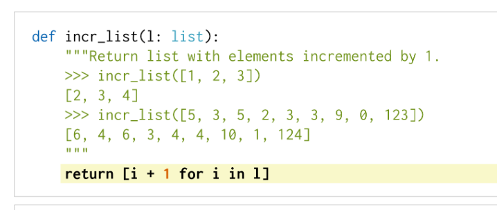
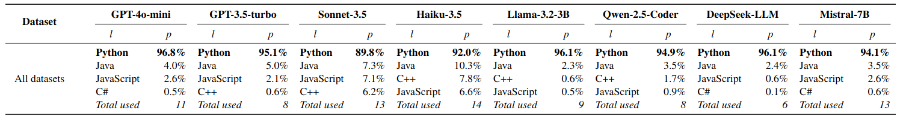
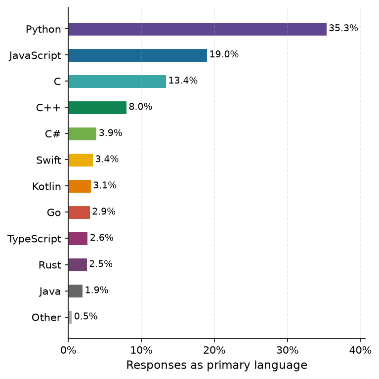
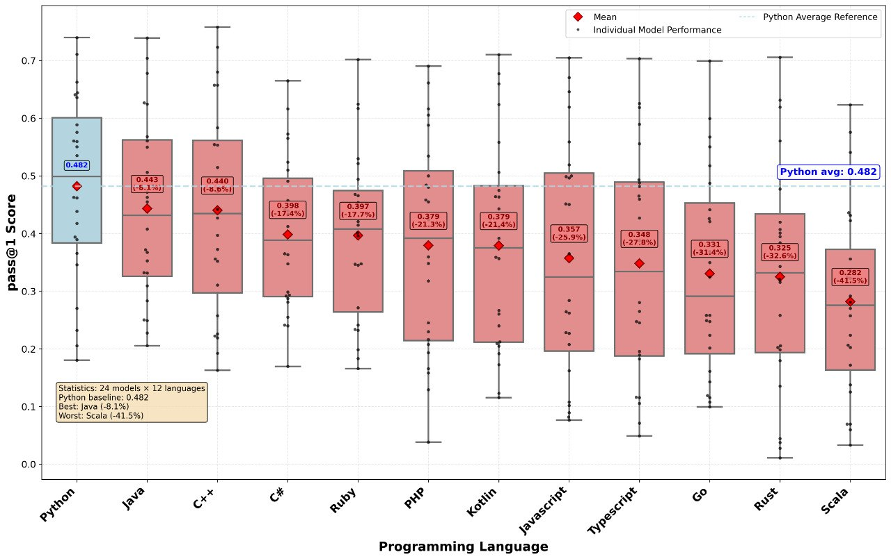
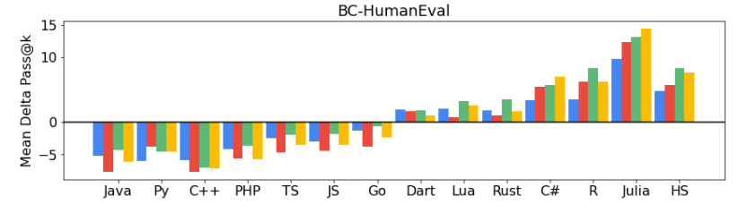
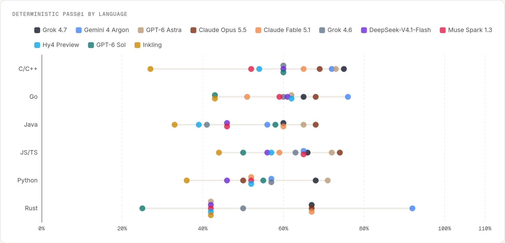
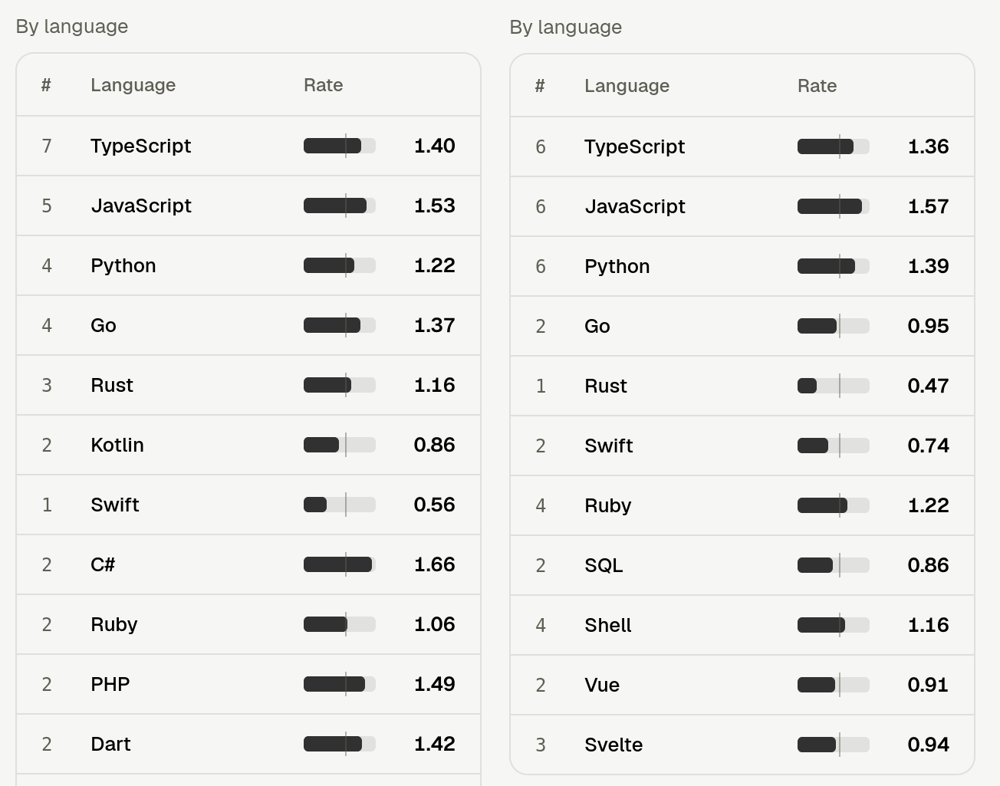

---

_This a writeup of my talk at the [Python Summit](https://pythonsummit.org/) on October 19th, 2026. See the talk recording [here](/talks/2026-10-19-python-summit-is-python-the-favorite-language-of-llms/)._

---

Do LLMs have preferences regarding programming languages? Why would they have any, and how would you notice it?

Online, you might occasionally have come across the statement that LLMs are better with Python, or that they really prefer to use Python even when they shouldn't. Many of us are very skeptical about this: LLMs shouldn't have preferences regarding programming languages. Or do they?

It turns out, this is a real research question, and some answers exist. In this post we will see what the research says about whether there is any preference from the LLM side regarding programming languages, what does that mean for your projects, and potentially for Python itself. Where might a bias like this be coming from? Was it just a thing of the past, or it's still a factor to keep in mind when starting a new project?

## What does “favorite” mean?

I'm going to focus on two different interpretations of this term: **preference** and **performance**.

On one side, let's try to understand whether LLMs are choosing a specific programming language above others, especially when you don't specify one. If you're asking an LLM to solve a programming task and you don't tell it which language to use, which one will it pick? Will it be Bash, TypeScript, or Python?

On the other hand, there is the question of performance. Are LLMs actually better at using Python than at using other languages? Could an LLM, given a programming task, have an easier time solving that task in Python versus another language? Or maybe do they write better idiomatic Python than idiomatic Rust? Is there any measurable difference between their capabilities with one language or another in terms of actual coding performance?

We're going to see both. But first, I want to understand a little bit about the history of this entire issue.

## Some history

The whole thing starts very early in the history of LLMs. Early models, like GPT-2 and GPT-3, were not trained to code at all. The idea of LLMs originally was to make them able to write text.

However, the researchers studying the emergent capabilities of these LLMs figured out that some code was included in the training set and, even without specific training for coding, if you give an LLM the name and the docstring of a function, the LLM was actually able to fill up the body of the function with some (usually) correct code. By learning how to speak, the LLMs somehow also learned how to do some basic programming, which was super exciting at the time (around 2020-2021).

_From "[Evaluating Large Language Models Trained on Code](https://arxiv.org/pdf/2107.03374)", Chen et al., 2021_

One of the first papers that described these capabilities **evaluated the LLMs on Python coding**. We don't really know why the researchers picked Python. They just picked this language and decided to go with it. In the paper they don't tell us why, whether they considered any other language, or whether they tried anything else. They probably stumbled upon this capability and kept digging into it, choosing Python kind of as an accident. So the early focus of investigation into these capabilities was focused on Python for completely accidental reasons.

Maybe the LLM was actually only able to write Python. Maybe the original researchers know about this, but we have no clue because this was just not part of the published paper. We are left wondering whether GPT-2 was able to do anything like this in any other language or not.

But clearly the research started from the emerging capabilities of LLMs to write _Python_ specifically, which may have had an impact later on.

## The preference gap

Now let's go back to our first question. Do LLMs pick Python more frequently than they would pick another language?

It definitely seems like this is the case, at least until quite recently. In a study of 2024–2025 models (GPT-3.5 Turbo, GPT-4, etc), the authors found that, when left unspecified, the programming language of choice of all (at the time) modern LLM was Python.

_From "[A Study of LLMs’ Preferences for Libraries and Programming Languages](https://arxiv.org/pdf/2503.17181v4)", Twist et al., 2026_

The results are quite impressive because the preference for Python is _stark_. When not specified, more than 90% of the time, for all of the models in this list, it was Python. Even when this was probably not a good choice to make!

In the paper, the researchers specify that in 58% of the projects where Python was clearly _not_ the right choice, the LLM would still pick Python for the implementation. And even if the LLM, when asked verbally “What would you choose for this project?” would pick another language, when actually tasked to implement it, it would still switch back to Python.

Again, it is not exactly clear where this came from. The paper offers no explanation apart from a few clues, and the conclusion is that this is just something that emerged accidentally. The LLM simply may have an easier time understanding Python code, maybe saw more Python in the training set. We don't really know. What we know is that the preference was there, and it was very strong.

To track the issue, the same authors recently made an update to their paper with a specific benchmark meant to measure this sort of programming language preference. They figured out that even for models as recent as GPT-5.4 or DeepSeek V4 Pro, even if the benchmark was designed to **contain only problems for which Python was clearly not the right choice**, still, in 35% of the cases, the LLM just switched back to using Python for the implementation. Anything else would have fit better, but not Python.

_From "[LANGCHOICEBENCH: Measuring and Explaining Programming-Language Choice in LLMs](https://arxiv.org/pdf/2608.06041v1)", Twist et al., 2026_

If the LLM would have no bias and would choose among all the languages available on their merits, this number should have been zero. However, a good third of the problems are still solved with Python!

This clearly says that even though we don't know where this comes from, **the preference is still there**, and it's still strong. We can wait for the next paper to see if the preference is still there with the even more recent models, or you can try to replicate their results yourself, but all clues point to the fact that this bias is definitely not a thing of the past.

## The performance gap

But how about performance? Do LLMs actually perform better with Python over other programming languages?

There are benchmarks out there that measure the difference in capabilities for solving programming problems in different languages. The **Multi-LCB benchmark** for example specifically shows that most models not only prefer Python, but are also **noticeably better at coding in Python** than in any other language.

The benchmark is composed of language-agnostic problems that the LLM is asked to solve several times in different languages: the once in Python, once in Java, once in C++, and so on. Then the researchers measured the success rate per language.

_From "[Multi-LCB: Extending LiveCodeBench to Multiple Programming Languages](https://arxiv.org/pdf/2608.06041v1)", Ivanova et al., 2026_

You can see that there is a significant, although not huge, higher success rate with Python.

The researchers called this phenomenon **“Python overfitting”** because it looks like the LLM is more capable of coding when it's writing Python than in other languages. It looks like the performance degrades significantly when you're using a language that the LLM, for some reason, seems to be less familiar or less proficient with. As if the LLM is overfitting around the syntax of Python or the way Python functions, and then tries to translate into other languages with varying success.

However, an interesting caveat of this paper is that they noticed some possible **test-data leakage**. This would mean that some of the test data maybe was included in the training of the LLMs that were tested, which would also clearly explain the advantage of the LLMs solving Python problems. However, taking the result at face value, we still see an advantage here.

In this paper the authors tested recent open-source models only, for example GPT-OSS-120B, Qwen Thinking, and DeepSeek R1. We don't know if this performance advantage translates to closed-source models, especially to more cutting-edge ones.

## Why does this happen?

Why do LLMs clearly show both a preference and a performance advantage when writing in Python?

There is not a clear explanation. Most of these properties are sort of emergent, and they were never designed to be this way. The teams who built the LLMs clearly never wanted it to be better at Python than Rust. This preference is somehow emergent from some other characteristic, either of the language or of the training data.

Let's see some hypothesis.

### Training data and Python's syntax

One of the strongest suspects here is the **training data**. Probably Python is just so overrepresented that LLMs learn better how to code in Python because they see so much more of it than anything else.

Also, Python has the advantage of its **syntax**. Python is very easy to parse for LLMs that are optimized for natural language. LLMs are designed to be able to read natural-language text, and Python really looks like one. If you think about Java or C++, they don't really look like English, while Python more or less does. It's possible that one of the advantages comes from the specific pseudocode-like nature of the language.

Another plus is that it's relatively easy for Python code to be right if it looks right. There is a relatively **low number of footguns**. If you think about C, it's much easier to write code look ok while still having very deep and complicated bugs. With Python, of course, it can happen as well, but it's less likely. It's designed to be a little bit more foolproof, which definitely helps the LLM learn to code in Python faster.

For comparison let's think about **Java**, which is often second in these preference and performance benchmarks. That makes sense because it's very popular, so plenty of it in the training set. It's also relatively easy to code with, so there aren't that many footguns. But if you think about the way you write it, the syntax is not as natural-language-like. It's more verbose and less natural-looking. The LLM probably has more difficulty writing it and parsing it than it has with Python.

**C and C++** have kind of the same problem. Again, very popular, with a lot of examples on the internet, but it's much more difficult to write correct code, and the syntax is also quite weird with respect to natural language.

**Go** and other easy-to-write languages, for example Lua, Julia, or other languages like these, were simply not popular enough at the time when the training was happening.

An interesting outlier, however, are **JavaScript and TypeScript**. It should have scored a bit better: it's hugely popular, probably even more popular even than Java and C++. There should be an incredible amount of examples on the internet, and the syntax is not dramatically more complex than Java. Why does it usually score so poorly? It's not clear. It should have been at least on par, if not more popular, and therefore easier for the LLM to learn. Somehow this lack of proficiency is even less explainable than the Python preference.

## Can the gap be closed?

Given that these are the potential explanations, can the gap between Python and the other languages be closed?

It seems like the answer is **yes**. Already in 2023 it was shown that if you train an LLM on a more balanced training set, the discrepancy kind of disappears.

_From "[Measuring the Impact of Programming Language Distribution](https://proceedings.mlr.press/v202/orlanski23a/orlanski23a.pdf)", Orlanski et al., 2023_

In the paper detailing this result, the evaluation benchmark was run on an LLM that was trained on a **balanced set** of programming material. Instead of taking a natural distribution from the internet, where clearly some languages are overrepresented, these researchers trained an LLM by removing most of the Java, Python, and C++ examples and adding many more examples of lower-frequency languages, like Rust, C#, Julia, or Haskell.

They could clearly see that, by rebalancing the training set, the advantage that LLMs had with Java, Python, and C++ was decreasing sharply, while the fluency of the LLMs in smaller and more niche languages increased dramatically. You can see this specifically for **Julia**, a niche programming language with a Python-like syntax. Just by adding a few more training samples, the performance in this language increased dramatically. Clearly, rebalancing datasets would help close the gap.

## A look at the frontier

So, is the performance gap still there at all? We've seen that some of the models tested were pretty recent, but there are always more recent models we can look at. And maybe more modern, more advanced benchmarks that we can check out.

### Cybersecurity

**[CWE-Bench](https://cwe-bench.com/)** is a benchmark focused on cybersecurity tasks which also provides programming language breakdowns. It's a live benchmark, so it's constantly updated with the very latest models that are available today.

_From [CWE-Bench](https://cwe-bench.com/)._

You can see that the picture is flipping already. Python is not the first language here: the first one now is C++, then there is Go, then Java, then JavaScript, and only in fifth position is Python.

This kind of makes sense: Python is not the most important language for cybersecurity, and most of the cybersecurity capabilities of LLMs are in languages that are more low-level, like C and C++, or compiled languages. So this performance gap is no longer such a clear-cut difference as we've seen before: in some niches, and definitely at the very cutting edge of the models available today, the advantage is not stark anymore.

### Bug rate

**[Cubic]()**, the PR review tool, also publishes bug-rate statistics by language for the models that generate the code it's reviewing. Let's look at the stats for two cutting edge models, GPT-6 Astra and Claude Opus 5.5.

_From the Cubic bug rate stats of [GPT 6 Astra](https://www.cubic.dev/bugbench/models/gpt-6-astra) and [Claude Opus 5.5](https://www.cubic.dev/bugbench/models/claude-opus-5-5)_

You can see that Python, interestingly, is in third position for both. The problem is that this is a benchmark where the **lower score is better**. Having Python in third position, just below JavaScript, means that this is **the third-worst** programming language, at least in terms of bug rate. Clearly it's not a good look for Python to be that high on this benchmark to begin with. It means that these newer models make a lot of mistakes with Python, more than they make, for example, with Go or Rust. 

This is another example of a benchmark where Python is not shining for models that are very modern. It seems like the difference is disappearing a bit.

## Is the gap fully gone?

This is much harder to say, because the data is just not there yet.

Most system cards simply **don't publish coding performance statistics broken down by programming language**. They just show general programming ability on benchmarks that are usually made of a balanced set of programming languages. This means that is really hard to tell whether these numbers are pushed up by string Python abilities or whether this gap is just not there anymore.

In general it seems that **the gap is decreasing**, because it's not difficult now to find benchmarks where Python is not scoring great. But it's not necessarily a good idea to extrapolate general performance judgements on benchmarks like these, and there is simply not a lot of focused research on this specific question. To have our answer, we might just need to wait for some more research to be published.

So, even today, it's always good to keep in mind that your LLM may be picking Python not exactly for its merits, but just because it really likes it.